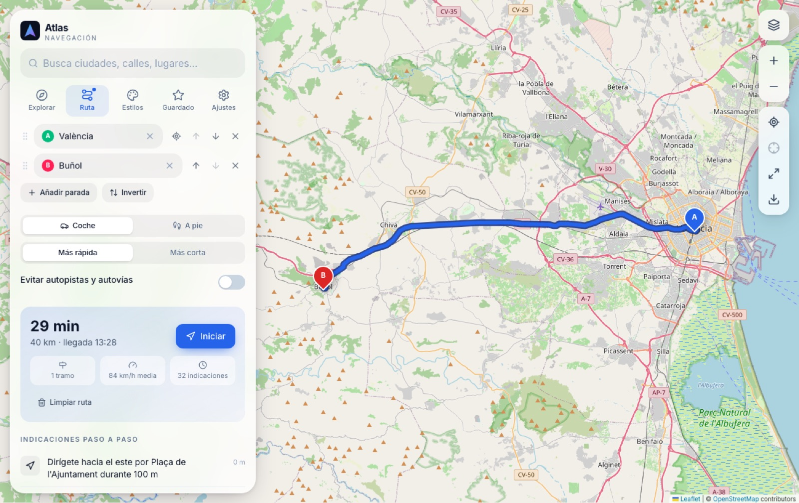
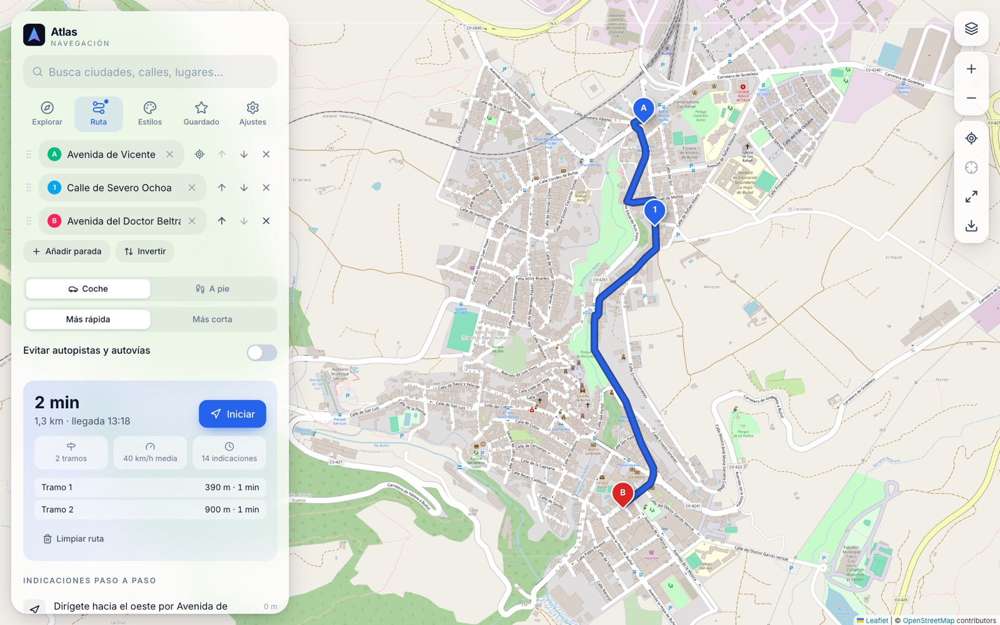
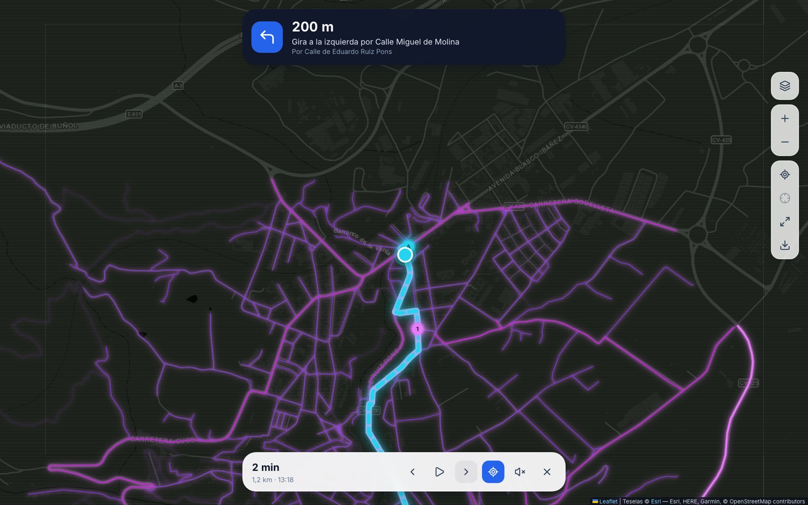
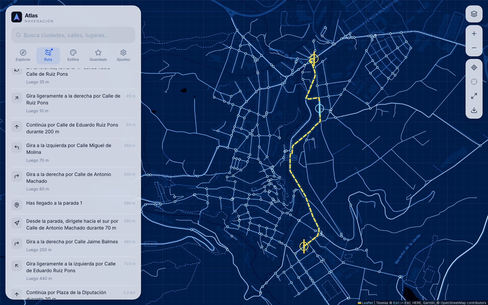

# Atlas · Navegación

Aplicación web de navegación con **ubicaciones y nombres reales de OpenStreetMap**, motor de rutas **A\*** propio, navegación paso a paso, paradas múltiples y **15 estilos visuales de mapa** (de clásico a cyberpunk, blueprint, arcade o fantasía).

**▶ Pruébala aquí: [ferrerversion.github.io/Atlas](https://ferrerversion.github.io/Atlas/)** · Funciona en ordenador y móvil, y se puede instalar como app.

La originalidad está en la interfaz, los estilos y las funcionalidades. **Ningún nombre geográfico se inventa**: ciudades, calles y establecimientos proceden siempre de OpenStreetMap. Solo en el editor de *mapas personalizados* el usuario puede nombrar libremente sus propios lugares.

---

## Características

- **Búsqueda** de ciudades, municipios, barrios, calles, POIs y coordenadas, con autocompletado, normalización de acentos y sin distinguir mayúsculas. Resultados con nombre real, tipo, dirección, icono y distancia aproximada. Resultados sin duplicados: una estación con sus paradas y andenes del mismo nombre es un solo resultado, y los tipos se etiquetan bien (Municipio, Estación de tren, Parada de autobús, Calle…). Las calles ya cargadas con el mismo nombre en dos pueblos aparecen por separado, cada una en su sitio.
- **Búsqueda por categoría** («gasolineras», «restaurantes cerca»…) y filtros de **POIs reales** (12 categorías) vía Overpass.
- **Mapa interactivo** (Leaflet): zoom con botones, rueda y pellizco, arrastre, centrado en el lugar seleccionado y en tu ubicación (si das permiso), ajuste automático a la ruta, menú contextual («Ruta desde aquí / hasta aquí / Añadir parada / ¿Qué hay aquí?»).
- **Motor de rutas A\*** sobre la red viaria real: sentidos únicos, rotondas, límites de velocidad, modo coche/a pie, ruta más rápida o más corta, evitar autopistas, detección de destinos inaccesibles.
- **Paradas múltiples**: añadir, eliminar, reordenar (botones o arrastrar), invertir; cálculo por tramos y unión sin nodos duplicados; marcadores arrastrables.
- **Medición en tiempo real con el GPS**: en cuanto hay una ruta, cada lectura del dispositivo actualiza lo que queda (distancia, tiempo, llegada), la próxima maniobra, la velocidad, la distancia recorrida y el tiempo de viaje. Indica la calidad de la señal, descarta saltos imposibles del GPS, avisa si te desvías y **recalcula la ruta desde tu posición** (manteniendo las paradas pendientes). La pantalla se mantiene encendida durante la navegación.
- **Navegación paso a paso** generada a partir de la geometría: giros (suaves, normales, bruscos), cambios de sentido, rotondas («toma la 2.ª salida»), incorporación y salida de autopista, llegada a paradas y destino. Modo navegación con próxima maniobra, distancia al giro, distancia y tiempo restantes, simulación del recorrido, seguimiento GPS y voz (síntesis local del navegador).
- **15 estilos de mapa** con selector, vista previa y persistencia. Cambiar de estilo no toca la búsqueda, la ruta, las paradas, las coordenadas, los nombres ni el grafo.
- **Modo noche** de la interfaz (claro / noche / automático) y mapa nocturno automático opcional.
- **Favoritos, historial y preferencias** persistidos en LocalStorage; datos geográficos cacheados en IndexedDB con caducidad (7 días) y límites (400 consultas, ~200 MB); lo caducado se borra al abrir la app. La red viaria en memoria tiene un tope (50.000 vías): al superarlo se liberan las zonas alejadas de lo que ves y de tu ruta.
- **Mapas personalizados**: carga local de PNG/JPG/WebP, calibración por puntos de referencia, nodos, vías, rutas A* y exportación/importación JSON.
- **Demo offline**: extracto real de OSM (Buñol) incluido en el repositorio.
- Diseño responsive: panel lateral en escritorio, buscador superior y panel inferior deslizable en móvil.

## Documentación

- **[docs/Atlas-Navegacion.pdf](docs/Atlas-Navegacion.pdf)**: guía completa en PDF (uso, estilos, arquitectura, motor A*, datos, pruebas, limitaciones). Se regenera con `npm run docs:pdf` a partir de `docs/documentacion.html`.

## Capturas



| Ruta con parada | Navegación en tiempo real | Blueprint |
|---|---|---|
|  |  |  |


Las capturas se pueden regenerar con `node e2e/visual-themes.mjs <carpeta>` (requiere `npx vite preview --port 4173` en marcha): genera una imagen por estilo con teselas reales y una ruta de ejemplo en Buñol.

## Stack

React 19 · TypeScript (estricto) · Vite · Tailwind CSS v4 · React Router · Zustand · Lucide React · Leaflet + React-Leaflet · idb-keyval · Vitest + Testing Library · Playwright · oxlint.

## Requisitos

- Node.js ≥ 20 (probado con Node 24) y npm.
- Conexión a Internet para teselas, búsqueda y descarga de calles (la demo offline funciona sin ella, salvo las teselas).

## Instalación y ejecución

```bash
npm install
npm run dev          # http://localhost:5173
```

### Ubicación del dispositivo (GPS)

- **La ubicación es opcional**: el mapa se abre siempre y se puede buscar y calcular rutas entre dos lugares sin dar permiso. El GPS solo se usa cuando lo pides: al pulsar *Mi ubicación*, *Usar mi ubicación como origen* o *Iniciar* la navegación. Si lo deniegas, se explica cómo activarlo y la app sigue funcionando. Hay un único seguimiento compartido por toda la app.
- **Ahorro de batería**: fuera de la navegación se usa la ubicación de precisión normal; el GPS de alta precisión (lecturas cada segundo) solo mientras navegas.
- **Mi ubicación** (botón de diana en los controles del mapa, resaltado cuando el seguimiento está activo): vuelve a centrar el mapa en tu posición.
- **Usar mi ubicación como origen** (icono junto al campo *Origen* en la pestaña Ruta).
- **Seguir mi ubicación GPS** en el modo navegación: la posición se proyecta sobre la ruta para avanzar las indicaciones.

La ubicación nunca se envía a ningún servidor. Los navegadores solo la permiten en **HTTPS o `localhost`**: en el ordenador basta `npm run dev`; para probarla **desde el móvil** en la misma red wifi:

```bash
npm run dev:movil    # https://<IP-del-ordenador>:5173 (certificado autofirmado)
```

Abre la URL «Network» en el móvil, acepta el aviso del certificado y concede el permiso de ubicación.

## Build

```bash
npm run build        # tsc -b + vite build → dist/
npm run preview
```

## Tests

```bash
npm test             # Vitest: 179 tests unitarios y de integración
npx playwright install chromium   # solo la primera vez
npm run test:e2e     # Playwright: 52 pruebas (26 en escritorio y 26 en móvil), sin red (datos OSM reales simulados)
npm run lint         # oxlint
```

> En macOS, si la pantalla entra en reposo Chromium deja de emitir `requestAnimationFrame` y los e2e se ralentizan o fallan. Ejecútalos con `caffeinate -dis npm run test:e2e`.

Cobertura de los tests: A* (ruta directa, varios tramos, óptima frente a alternativa, sentido único, inalcanzable, nodo inexistente, grafo vacío, varios caminos, geometría, distancia, tiempo, reconstrucción, ausencia de ciclos), construcción del grafo desde OSM, instrucciones (giros, rotondas, autopistas), multi-parada, progreso de navegación, planificación de descargas, búsqueda y normalización, adaptadores Photon/Nominatim, temas, store (cambiar tema no borra ruta), persistencia (el GPS y la navegación no escriben en el navegador ni repintan la app), uso sin ubicación, calibración de imágenes, limitador de peticiones y componentes de UI.

## Rendimiento

**Medición con los servicios reales** (26/11/2026, Chromium, ruta Valencia → Buñol de 40 km, ubicación en Valencia). Overpass es un servicio público y su respuesta varía muchísimo según la carga del momento, así que cada cifra es una ejecución concreta:

| | Tiempo hasta ver la ruta (cada cifra, una ejecución) | Datos de Overpass durante la ruta |
|---|---|---|
| Versión anterior (misma consulta en paralelo en varios espejos a los 6 s) | 30 s, 38 s, 42 s, 43 s, 90 s | 13-17 MB |
| Espejos estrictamente de uno en uno | 72 s, 76 s, 112 s, 157 s | 7-13 MB |
| **Versión actual** (de uno en uno + un único respaldo a los 15 s) | 57 s, 62 s, 115 s, 163 s | 13 MB |

La ruta fue de 30-33 min y 39-41 km en todas las ejecuciones (31 min y 40 km en todas las de la versión actual). En esas mediciones `overpass-api.de` respondía 502 a casi todo, `overpass.private.coffee` se quedaba colgado y `maps.mail.ru` daba algún 504: el tiempo lo marca el estado de los servidores públicos. Lanzar menos consultas duplicadas es más respetuoso con ellos, pero con servidores saturados la ruta tarda más que antes. La solución de fondo es un motor de rutas o un Overpass propios (ver *Limitaciones*).

**Medición con servicios simulados** (mismo extracto real de Buñol, sin red, versión anterior frente a la actual):

| | Antes | Ahora |
|---|---|---|
| Consultas Overpass al abrir la app (8 s) | 11 (9 de la zona de 200 km) | **0** |
| Teselas pedidas al abrir la app (8 s) | 720 | **54** |
| Consultas Overpass en una ruta corta dentro de Buñol | 14 (11 de la zona de 200 km, 2 anillos de 5 km, 1 corredor) | **4** (solo calles cercanas) |
| Uso del GPS al abrir la app | sí (obligatorio) | **no** (solo si lo pides) |
| Escrituras en localStorage con 20 lecturas del GPS | 60 | **0** |
| Escrituras en localStorage en 3 s de simulación | 362 | **0** |

Cómo:
- **Descargas en paralelo**: los trozos de red viaria (corredor, calles cercanas, anillos de acceso) se piden de 2 en 2, el más pesado primero.
- **Precarga**: al elegir una parada se empiezan a bajar sus calles antes de tener la ruta.
- **Sin duplicados**: si la misma consulta ya está en curso, se reutiliza.
- **PWA / service worker**: la app y las teselas ya vistas se guardan en el dispositivo (14 días). La web se puede instalar como app y el mapa ya visitado funciona sin conexión.
- **Librerías en paquetes propios** (React, Leaflet, router), que se cachean entre versiones; **conexiones anticipadas** (*preconnect*) a los servidores de teselas y búsqueda.
- **Menos esperas**: buscador 180 ms (0 si ya está en caché), carga de calles y POIs 400 ms.
- **Búsqueda en dos fases**: coordenadas, categorías, favoritos, historial y calles ya cargadas aparecen al instante; el servidor completa después.
- **Clic en el mapa instantáneo**: el punto se usa al momento y su nombre real (Nominatim) se rellena cuando llega, sin recalcular.
- **Rejilla de celdas compartida**: la carga del mapa, la precarga de paradas y las rutas reutilizan las mismas celdas de calles (nunca se piden dos veces).
- **Overpass**: se recuerda entre visitas el último servidor que respondió y se empieza por él; los demás espejos solo se prueban si ese falla.
- **Movimiento fluido**: la posición se anima fotograma a fotograma entre lecturas del GPS y el mapa la acompaña sin tirones.
- **Mapa precargado alrededor de la pantalla**: un anillo extra de teselas y 600 m de calles de margen; también carga mientras se arrastra.
- **Ruta provisional**: en cuanto los datos llegados permiten una ruta real se muestra, y se afina al terminar la descarga. Al elegir una parada se precargan solo sus calles cercanas (el anillo de acceso de 5 km se descarga únicamente si la ruta resulta ser larga); como mucho 2 consultas reales a Overpass a la vez.
- **Sin descargas de fondo masivas**: no se precarga ninguna zona alrededor del usuario ni un corredor alrededor de la ruta (versiones anteriores lo hacían: unas 15 consultas Overpass pesadas y ~300 teselas por capa en cada visita). Solo se descarga lo que se ve o lo que necesita la ruta.
- **Estado separado**: el GPS, la medición en vivo y el avance de la navegación viven en un store propio que nunca se guarda en el navegador; las preferencias solo se escriben cuando cambian. Cada proceso sin interfaz (rutas, POIs, calles, navegación) va en su propio componente, así una lectura del GPS no repinta el mapa ni los paneles.
- **Arranque**: pantalla inicial en el propio HTML, estilos y registro de la PWA que no bloquean el pintado, paneles secundarios y modo navegación descargados aparte (precargados en reposo) y teselas sin fundido.

Para medirlo: `npx vite preview --port 4173` y `node scripts/perf-ux.mjs` (servicios simulados con latencias realistas).

Construir el grafo y calcular A* no es el cuello de botella: con 15 000 vías reales tarda unos 100 ms.

## Arquitectura

```
src/
├── app/            App, router, providers (modo claro/noche)
├── components/     Interfaz (sin lógica de negocio)
│   ├── layout/     AppShell, Sidebar, MobileNavigation, pestañas
│   ├── map/        MapView, capas temáticas, RoadLayer, StreetLabels, RouteLayer, marcadores, controles
│   ├── search/     SearchBar, PlaceAutocomplete, SearchResults
│   ├── navigation/ RoutePanel, WaypointList, RouteSummary, NavigationInstructions, NavigationHUD
│   ├── explore/    Ficha del lugar y POIs
│   ├── themes/     Galería y vistas previas
│   ├── customMap/  Editor de mapas personalizados
│   └── ui/         Botones, controles, toasts
├── features/       Lógica independiente de la UI
│   ├── routing/    graph.ts, astar.ts, routeInstructions.ts, routeService.ts, routeTypes.ts
│   ├── geocoding/  Proveedores Photon / Nominatim (intercambiables)
│   ├── search/     Búsqueda combinada, local y por categorías
│   ├── osm/        Overpass, almacén de red viaria, datos demo
│   ├── poi/        Categorías y parseo de POIs
│   ├── navigation/ Progreso de navegación
│   ├── map/        Proveedores de teselas, utilidades de marcadores
│   ├── themes/     Tipos, registro y un archivo por tema
│   └── customMap/  Calibración afín, persistencia y exportación
├── data/           Extracto OSM real (Buñol) para modo offline y tests
├── hooks/          Cálculo de rutas, carga de POIs/calles, GPS, navegación, búsqueda
├── store/          Estado global (Zustand + persistencia parcial)
├── styles/         globals.css (Tailwind) y map.css (efectos, marcadores)
├── utils/          Distancias, geometría, HTTP limitado, almacenamiento
└── tests/          Vitest
e2e/                Playwright
scripts/            Descarga de extractos OSM
```

Separación clave: **UI** (`components/`), **datos geográficos** (`features/osm`, `data/`), **motor de rutas** (`features/routing`, puro y testeado), **servicios externos** (`geocoding`, `overpassService`), **estilos** (`features/themes`) y **datos personalizados** (`features/customMap`).

## Algoritmo A*

1. **Grafo** (`graph.ts`): las vías OSM (`highway=*`) se dividen en las intersecciones (nodos compartidos por varias vías) y, en vías largas, cada ~250 m para mejorar el ajuste. Cada arista conserva la geometría completa, el nombre/ref real, el tipo de vía y la velocidad (`maxspeed` o valor por defecto por tipo). Las vías de doble sentido generan dos aristas dirigidas; `oneway=yes/-1`, rotondas y autopistas solo una. **Restricciones de acceso** con la jerarquía de OSM: manda la etiqueta más específica (en coche `motorcar` > `motor_vehicle` > `vehicle` > `access`; a pie `foot` > `access`). Así una zona peatonal con `access=no` + `foot=yes` se puede recorrer a pie, y una calle con `access=no` + `motor_vehicle=yes`, en coche.
2. **Ajuste a la red**: cada parada se proyecta sobre el **punto exacto** de la calle más cercana (máx. 1,5 km) y el tramo se parte con un nodo temporal, así la ruta sale de donde estás en cualquier sentido permitido. En coche se usan también los **caminos** (`highway=track`) sin restricción de acceso, a velocidad baja (12-30 km/h según su firmeza), porque son el acceso habitual a casas de campo y urbanizaciones.
3. **Tiempo realista** (`travelTime.ts`): en cada vértice se estima el radio de la curva y su velocidad cómoda, v = √(2,6 m/s² · R); entre curvas se acelera a 1,2 m/s² y se frena a 2 m/s², así una carretera de montaña limitada a 90 sale a ~50 km/h de media y una autovía a ~110. Cada giro, rotonda o incorporación suma unos segundos. Ejemplo real: Buñol → Yátova pasa de 7,9 min (solo límites) a 10,5 min; Valencia → Buñol, de 29 a 31 min.
4. **Búsqueda** (`astar.ts`): montículo binario, coste = tiempo realista o distancia; heurística = distancia haversine al destino (dividida por la velocidad máxima del grafo en modo «más rápida»), que nunca sobreestima → ruta óptima. Conjunto cerrado y descarte de entradas obsoletas → sin bucles infinitos. Devuelve `RouteResult` con nodos, aristas, distancia, tiempo y geometría, o un error tipado (`empty-graph`, `node-not-found`, `unreachable`, `limit-exceeded`).
5. **Instrucciones** (`routeInstructions.ts`): ángulo entre el rumbo de llegada y el de salida (medidos a 20 m del nodo), número de alternativas en el cruce, cambios de nombre, rotondas y transiciones de autopista.
6. **Descarga de datos** (`routeService.ts`): trayectos cortos → todas las calles del área. Trayectos largos → por trozos con caché propia: calles de coche a 1 km de cada parada, un **anillo de acceso** de 5 km (secundarias, terciarias y sin clasificar, que son las que unen cada núcleo con las autovías) y un corredor de vías principales. Si aun así las paradas no conectan, el corredor se amplía un nivel. Ejemplo real: Buñol solo enlaza con la A-3 por la CV-425, a ~2,7 km del centro; sin el anillo, la ruta Valencia→Buñol daba un rodeo de 46 km por Chiva en lugar de los 40 km reales. Si la zona ya está cargada no se vuelve a pedir. A pie se descargan todas las calles y caminos, pero solo a lo largo de cada tramo (con un margen del 10 % de su longitud, entre 600 m y 1,5 km); si no conectan, el margen se amplía una vez. Las celdas se piden por bloques de como mucho 6×6 (~10 × 8 km) y nunca se recortan. Si alguna descarga falla, la ruta se calcula con lo que llegó y se marca como **aproximada** en el resumen.

Si no hay datos de carreteras, **no se inventa una ruta**: se informa del motivo.

## Fuentes cartográficas

| Uso | Servicio | Notas |
|---|---|---|
| Autocompletado | [Photon](https://photon.komoot.io) (komoot, datos OSM) | Diseñado para búsqueda mientras se escribe. Antirrebote 220 ms, mín. 3 letras, caché. |
| Búsqueda completa y geocodificación inversa | [Nominatim](https://nominatim.org) (OSMF) | [Política](https://operations.osmfoundation.org/policies/nominatim/): **máx. 1 petición/s**, sin autocompletado → solo al pulsar Enter o elegir un punto del mapa. |
| Red viaria y POIs | [Overpass API](https://wiki.openstreetmap.org/wiki/Overpass_API) | Como mucho 2 consultas a la vez y 0,6 s entre inicios, caché IndexedDB de 7 días, zonas acotadas. Los espejos se prueban **de uno en uno**: si uno falla se pasa al siguiente. Única excepción: si no ha respondido en 15 s (30 s en consultas grandes) se lanza **un solo respaldo** en otro espejo y gana el primero que responda (nunca más de 2 servidores a la vez por consulta). Tiempo máximo por servidor: 25 s (60 s en consultas grandes). Los que responden 429/5xx se reintentan hasta 2 veces (a los 4 s y a los 8 s). |
| Teselas | OpenStreetMap estándar, Esri (World Imagery, Light/Dark Gray Canvas), OpenTopoMap | Ninguna requiere clave API. Los basemaps de CARTO pasaron a exigir clave y no se usan. |

### Configurar fuentes alternativas

Crea un `.env.local`:

```bash
VITE_PHOTON_URL=https://mi-photon.example.org
VITE_NOMINATIM_URL=https://mi-nominatim.example.org
VITE_OVERPASS_URLS=https://mi-overpass.example.org/api/interpreter,https://overpass.private.coffee/api/interpreter
```

Para teselas, añade un proveedor en `src/features/map/tileProviders.ts` y referéncialo desde un tema. Para otro geocodificador, implementa la interfaz `GeocodingProvider` (`geocodingService.ts`) y asígnalo en `geocoding`.

### Trabajar con datos locales

```bash
npm run data:demo                                   # Buñol (por defecto)
node scripts/fetch-osm-extract.mjs "Nombre" s,w,n,e # otra zona (bbox pequeño)
```

Genera `src/data/demoRoads.json`, `demoPOIs.json` y `demoCity.json` con datos reales. En la app: *Ajustes → Cargar demo offline*.

## Licencias y atribuciones

- Datos: **© OpenStreetMap contributors**, [ODbL 1.0](https://www.openstreetmap.org/copyright). El extracto de `src/data/` está bajo ODbL.
- Teselas OSM: [Tile Usage Policy](https://operations.osmfoundation.org/policies/tiles/) (uso ligero, atribución obligatoria).
- Esri World Imagery / Canvas: © Esri y proveedores (Maxar, Earthstar Geographics, HERE, Garmin…), según los términos de Esri.
- OpenTopoMap: CC-BY-SA, © OpenTopoMap, SRTM.
- Photon: © komoot (datos OSM). Nominatim: © OSMF.
- Fuentes tipográficas (Inter, Orbitron, Press Start 2P, JetBrains Mono, Cinzel, Caveat): SIL Open Font License, servidas localmente con @fontsource (sin peticiones a Google Fonts).

La atribución se muestra siempre en el mapa y en *Ajustes → Fuentes y licencias*.

## Sistema de temas

Cada tema (`src/features/themes/themes/*.ts`) define: colores (fondo, agua, parques, edificios, calles, principales, autopistas, ruta, etiquetas, marcadores, acento), tipografía (familia, tamaño, peso, mayúsculas, espaciado), nivel de detalle, capa base y de etiquetas (proveedor, filtro CSS, opacidad, zoom máximo, pixelado), capa vectorial propia por clase de vía (color, grosor, discontinuidad, carcasa), nodos visibles, etiquetas de calle propias, estilo de ruta (color, carcasa, animación, resplandor), forma de marcador, estilo de POI y efectos (resplandor, sombras, animaciones, scanlines, rejilla, viñeta, papel, ciclo de color).

| Estilo | Base | Rasgos |
|---|---|---|
| Clásico | OSM | Familiar y legible |
| Satélite | Esri World Imagery | Calles OSM superpuestas, etiquetas opcionales |
| Oscuro Premium | Esri Dark Gray | Autopistas ámbar, ruta cian con resplandor |
| Minimalista | Esri Light Gray | Gris, sin decoración |
| Cyberpunk | Dark Gray recoloreado | Neón magenta/cian, ruta animada, Orbitron, scanlines |
| Mundo Abierto | OSM saturado | Carreteras gruesas con carcasa, viñeta, marcadores rombo |
| Blueprint | Dark Gray azulado | Trazos técnicos, rejilla, intersecciones, monoespaciada |
| Retro Arcade | Teselas pixeladas | Colores intensos, iconos y tipografía de 8 bits |
| Fantasía | OpenTopoMap sepia | Relieve real, caminos a tinta, papel, sellos de lacre |
| Caótico / Experimental | OSM con ciclo de color | Trazos discontinuos, marcadores que respiran |
| Vintage, Blanco y negro, Topográfico, Dibujo a mano, Holográfico | — | Estilos adicionales |

Los efectos se desactivan con `prefers-reduced-motion`.

### Cómo añadir un estilo

1. Crea `src/features/themes/themes/miTema.ts` con `defineTheme({...})` (usa otro tema como plantilla).
2. Añádelo al array `THEMES` de `themeRegistry.ts`.
3. `npm test` valida automáticamente ids únicos, colores, proveedores y que sea distinto de los demás.

## Cómo añadir puntos de interés

Añade una entrada a `POI_CATEGORIES` en `src/features/poi/poiTypes.ts` con: id, etiquetas, icono (regístralo en `src/features/map/icons.ts`), color, selectores Overpass, palabras clave de búsqueda, radio y función `matches(tags)`. Los POIs siempre se descargan de OSM; los que no tienen nombre se muestran como «(sin nombre en OSM)».

## Cómo cambiar de ubicación

Busca cualquier lugar (p. ej. «Valencia», «Buñol», «Madrid», «Barcelona») o arrastra el mapa. Al acercarte (zoom ≥ 15) se descargan automáticamente las calles reales de la zona (desactivable en Ajustes) o con el botón de descarga. Las rutas descargan lo necesario por sí solas.

## Mapas personalizados

Ruta `/custom` (Ajustes → *Abrir editor de mapas*):

1. Carga una imagen PNG/JPG/WebP (se lee con `FileReader`, **nunca sale del navegador**; máx. 15 MB, 8192 px por lado y 40 megapíxeles).
2. **Calibrar**: pulsa puntos reconocibles y escribe sus coordenadas. Con 2 puntos se calcula una semejanza (escala + rotación + traslación); con 3 o más, una transformación afín por mínimos cuadrados con su error medio. Sin referencias puedes fijar escala (m/píxel) y rotación manuales.
3. **Nodos**: clic para crear intersecciones y nómbralas libremente.
4. **Vías**: pulsa dos nodos para conectarlos (nombre, tipo, velocidad, sentido único).
5. **Ruta**: elige origen y destino → A* con instrucciones.
6. **Exportar** a JSON (opcionalmente con la imagen) e importarlo después. Se autoguarda en IndexedDB (los mapas propios nunca se borran solos). Al importar se valida todo el archivo (máx. 30 MB, 5.000 nodos y 20.000 vías, coordenadas posibles) y la imagen solo se acepta incrustada en el propio archivo (PNG, JPG o WebP), nunca como dirección externa.

Limitaciones: proyección plana local (precisa para zonas de pocos km); las vías son tramos rectos entre nodos; la imagen calibrada no se superpone aún sobre el mapa real.

## Limitaciones

- **El cálculo de rutas descarga la red viaria en vivo desde Overpass**, un servicio público gratuito: con el servidor saturado una ruta puede tardar decenas de segundos (ver *Rendimiento*). Overpass, Photon, Nominatim y las teselas tienen políticas de uso ligero; la app limita sus consultas, pero para uso intensivo hay que desplegar instancias propias (o un motor de rutas en servidor).
- El autocompletado (Photon) solo conoce el nombre oficial local de OSM (p. ej. «València») y no admite el español. Al elegir un municipio, región o país se consulta una vez su nombre en español de OSM (`name:es`, con Nominatim `/lookup`) y se recuerda: la ficha y las búsquedas siguientes muestran «Valencia». La primera lista, antes de elegir, aún puede mostrar el nombre local. Las calles y comercios conservan su nombre de OSM sin traducir.
- Rutas en vivo hasta ~300 km en coche (~25 km a pie); en trayectos largos solo se descargan vías principales en el corredor.
- No hay tráfico en tiempo real, restricciones de giro (`turn restrictions`) ni carriles; los tiempos no consideran pendientes (no hay datos de elevación), así que en puertos de montaña pueden quedarse algo cortos.
- Las capas Esri Canvas tienen detalle nativo hasta zoom 16; por encima, las calles se dibujan en vectorial a partir de OSM.
- Los colores de agua/parques/edificios de cada tema se aplican mediante filtros sobre teselas ráster (no hay teselas vectoriales).
- Rotación del mapa no implementada (Leaflet no la soporta de forma nativa).
- La primera visita depende de descargar las teselas del mapa (~660 kB de imágenes); las siguientes salen de la caché local.

## Próximas mejoras

- Restricciones de giro y perfiles de bicicleta.
- Teselas vectoriales (MapLibre) para recolorear agua/parques de forma exacta y rotar el mapa.
- Web Worker para construir el grafo y ejecutar A* en zonas grandes.
- Superponer mapas personalizados calibrados sobre el mapa real.
- Importación de archivos `.osm`/`.pbf` y GeoJSON arbitrarios.

## Autor

**Jorge Ferrer Gil**, desarrollador de aplicaciones multiplataforma.
[Portafolio](https://ferrerversion.github.io/FerrerVersion/) · [LinkedIn](https://www.linkedin.com/in/jorge-ferrer-gil-5008b423a/)
